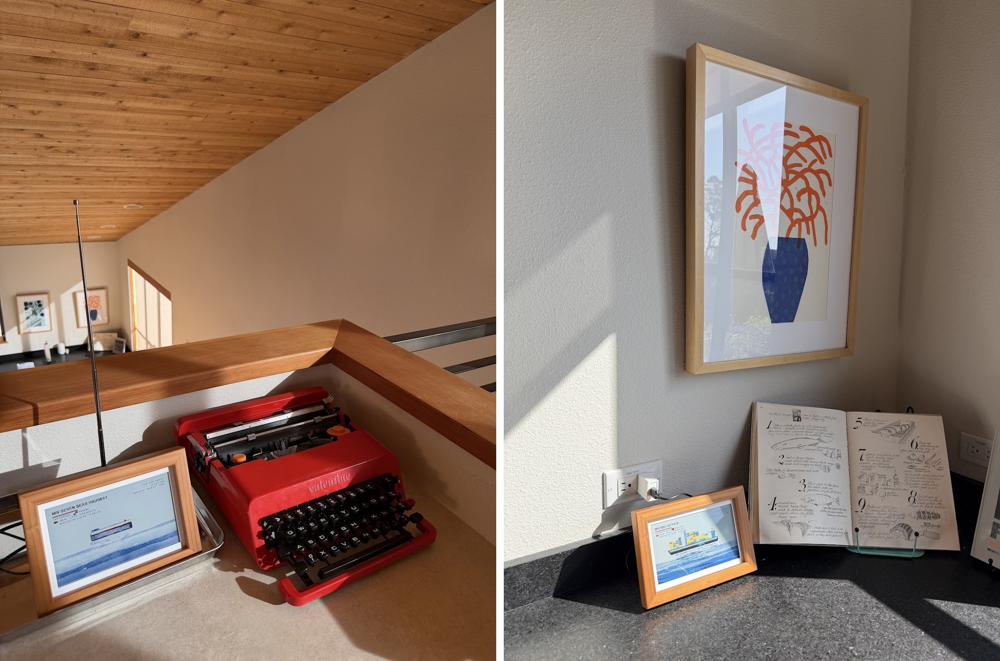
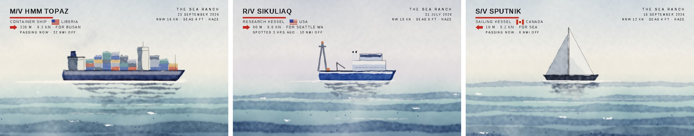
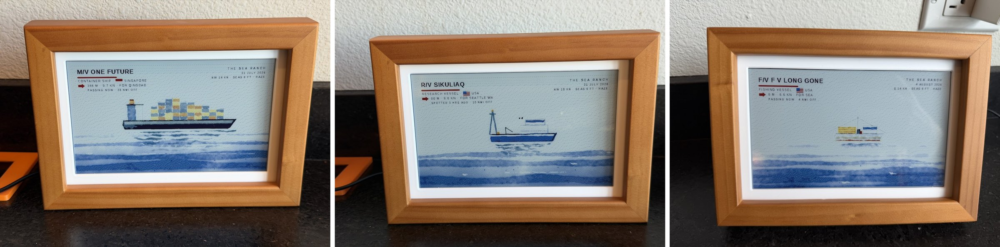
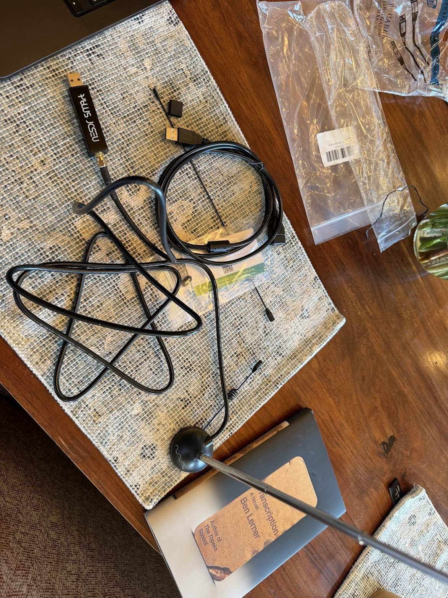
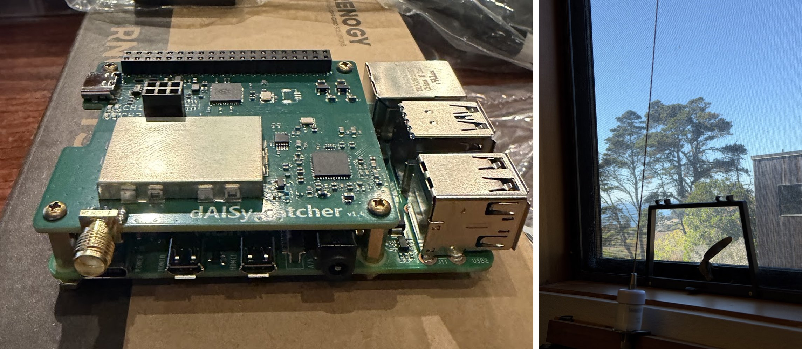
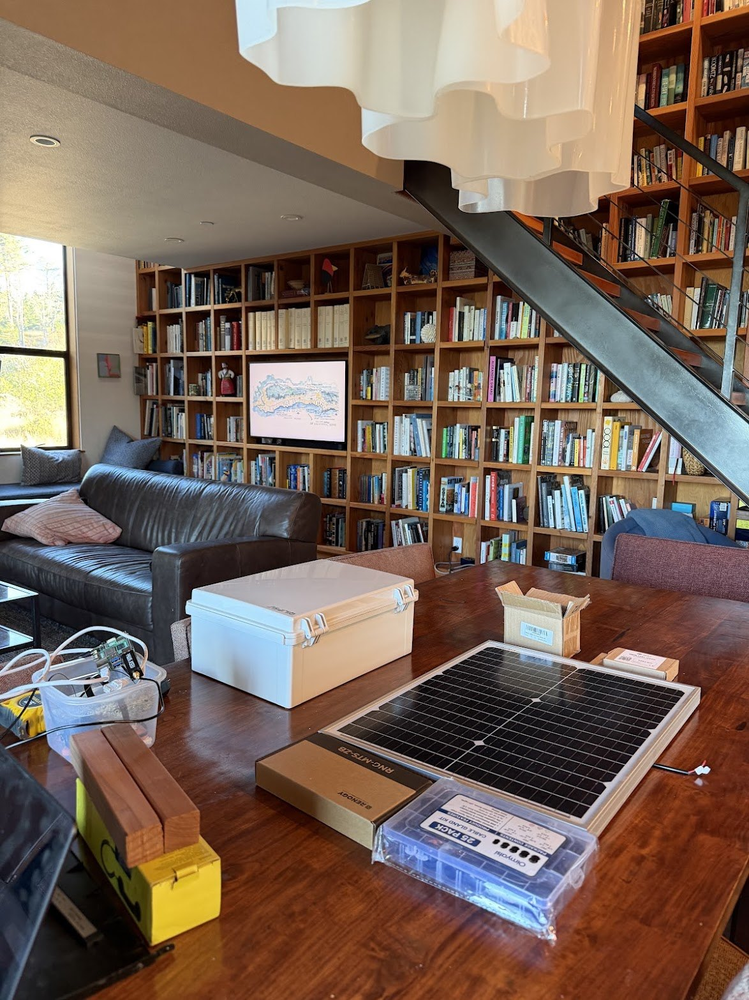

# Passing Ships

*A painting that paints itself. Every hour, a real ship passing your coast.*

**See it live:** [pacificpike.com/ships](https://pacificpike.com/ships/) · **Hear what it hears:** [AIS station 3610](https://www.aiscatcher.org/station/3610)



*Left: day one, in the loft, with a $55 radio on a cookie sheet. Right: where it lives now.*

---

## The idea

One day while looking out at the horizon in Sea Ranch, CA with some binoculars, I saw a boat and wondered where it might be headed.

Turns out that big ships, and plenty of small boats, announce their name, size, speed and destination over marine VHF radio. It's called AIS, it's how ships avoid smacking into each other, and it's completely public.

So I built a picture frame that listens to those signals and paints watercolor paintings of the ships. An antenna in a window hears the signal of who's out there. No ship-tracking website or API involved. If the frame paints it, my antenna heard it. A Raspberry Pi inside a picture frame picks the most interesting ship, pulls the real wind and swell off the nearest NOAA buoy, and paints it as a watercolor on a color e-ink panel. Every hour, day and night. 250 paintings since July 2026, ranging from the 8-meter *F/V Long Gone* to the 336-meter *HMM Topaz* cargo ship.

The idea is inspired, with love, by Teddy Warner's [AvianVisitors](https://theodore.net/projects/AvianVisitors/) ([GitHub](https://github.com/Twarner491/AvianVisitors)): a Pi that listens for birdsong and collages the birds in your yard onto a framed e-ink panel. Same shape of a project, but using radio signals from boats instead of birdsong.

Note: I'm a non-technical lawyer. I can't really code. I built this with [Claude Code](https://claude.com/claude-code), mostly by telling Claude what I wanted to build, snapping pictures of electronic components, and critiquing watercolor paintings until I found something I thought looked nice.

---

## What's in a painting

No photos, no stock art, no generative image model. The paintings are procedural: a program draws each one from that ship's own broadcast, so the frame needs no API key and no two come out alike.



- **Shape.** Fifteen kinds of vessel, from container ship to Coast Guard cutter to a tug with a barge on a towline. The research ship gets a gantry on the stern because research ships have one.
- **Colors.** ONE's magenta, Maersk's blue, Matson's navy. Container stacks are a mixed pile, because carriers lease most of their boxes. Even Maersk.
- **Load.** Ships broadcast how deep they sit. An empty one rides high and shows its bottom paint.
- **Age.** Older hulls get rust.
- **Weather.** Fog, haze, wind and swell come from the buoy, and they change the sky, the water, and how much of the ship dissolves into the distance.
- **Sky.** Light from the hour the ship passed. After dark you get the real moon in its real phase, lit windows, and proper running lights: red when sailing left, green when sailing right.
- **Caption.** Name, type, flag, size, speed, destination, how far off, and when.

The panel only has six inks, so every color on the wall is really dots of black, white, red, yellow, blue and green. Here's what that looks like in person:



---

## BOM

What I run today. Everything screws or plugs together. No soldering.

### The frame

| Qty | Description | ~Price | Link | Notes |
|---|---|---|---|---|
| 1 | Waveshare 7.3" E6 full-color e-paper in a solid wood photo frame, Raspberry Pi Zero version | $96 | [Waveshare](https://www.waveshare.com/rpi-zero-photopainter-acce.htm) · [Amazon](https://www.amazon.com/s?k=Waveshare+7.3+PhotoPainter+E6+wood+frame) | 800 × 480, six inks. You don't need the battery. |
| 1 | Raspberry Pi Zero 2 **WH** | $18 | [Amazon](https://www.amazon.com/s?k=Raspberry+Pi+Zero+2+WH) | The **H** means the header pins are already on, which is what keeps this solder-free. Waveshare also sells the frame with a board included. |
| 1 | 32 GB microSD | $8 | any | |
| 1 | 5V USB charger and cable | $5 | your junk drawer | |

### The radio

| Qty | Description | ~Price | Link | Notes |
|---|---|---|---|---|
| 1 | Wegmatt dAISy-catcher high-performance AIS receiver | $149 | [Wegmatt](https://shop.wegmatt.com/products/daisy-catcher-high-performance-ais-receiver) | A dedicated two-channel AIS receiver that stacks on the Pi |
| 1 | Stacking kit, 11 mm, for dAISy-catcher | $4 | [Wegmatt](https://shop.wegmatt.com/products/stacking-kit-11mm-for-daisy-catcher) | Was free with the receiver when I ordered |
| 1 | Raspberry Pi 4 case for dAISy-catcher | $14 | [Wegmatt](https://shop.wegmatt.com/products/raspberry-pi-4-case-for-daisy-hat) | Fits with the 11 mm kit, not the taller ones |
| 1 | Shakespeare 5215-AIS antenna | $78 | [Amazon](https://www.amazon.com/s?k=Shakespeare+5215-AIS) | 3 ft stainless whip. Must say **-AIS**. The plain 5215 is tuned for voice. |
| 1 | Coax, SMA-male to PL-259, 15 ft | $13 | [Amazon](https://www.amazon.com/dp/B09JW6Z9K9) | PL-259 end on the antenna, SMA end into the receiver |
| 1 | Raspberry Pi 4 kit, 2 GB, with its official power supply | $60 | [Amazon](https://www.amazon.com/s?k=CanaKit+Raspberry+Pi+4+Basic+Kit+2GB) | Skip the fan and heatsinks under the receiver |
| 1 | 32 GB microSD | $8 | any | |

About **$450** all in.

---

## The radio, three tries

The frame has stayed the same. The radio is on its second version, and the third is in boxes on my dining table.

### Version 1: a dongle on a cookie sheet (July to October)



A [Nooelec NESDR SMArt v5 bundle](https://www.nooelec.com/store/nesdr-smart.html) ($55): a USB radio the size of a pack of gum, plus a telescoping whip on a magnet. Set the whip to 44 cm (a quarter wave at 162 MHz, physics is fun) and stand it on a steel cookie sheet, which acts as the other half of the antenna.

It works! It got the whole project off the ground, and it's still the cheap way in. Keep the Pi 4 and its card, swap the dongle in for the rest of the radio table, and the whole build comes to **about $250**.

It also runs hot enough to lock itself up and go deaf. I ended up cutting its power for 25 minutes of every hour (`--duty-cycle`) just to keep it alive. And don't run it from a Pi Zero on a phone charger. Mine sprayed noise across the exact band I was trying to hear.

### Version 2: a real receiver and a real antenna (October)



The dAISy-catcher does one job. No tuning, no gain knob, no heat problem. The Shakespeare whip is cut for AIS at the factory. The two of them sit in a window, behind glass and a bug screen, which is a terrible place for an antenna.

| | Version 1, one August evening | Version 2, one October afternoon |
|---|---|---|
| Messages in an hour | 281 | about 8,000 |
| Vessels | 5 | 40-odd |
| Farthest | 73 nautical miles | 668 nautical miles |

That last number isn't a typo. When the air over the ocean layers up just right, VHF bends over the horizon and I hear ships off Baja.

### Version 3: off the grid (next)



The antenna wants to be outside and up high. So the next version moves the whole radio off grid: solar panel, battery, Pi, receiver and antenna, all in one waterproof box. No house wiring, no hole in the wall.

The parts are bought and sitting on the table. **This is my shopping list, not a recipe.** I haven't built it or measured what it draws, so sizes may change. I'll add the wiring, photos and what I got wrong once it's built.

| Qty | Description | ~Price | Link |
|---|---|---|---|
| 1 | Newpowa 35 W 12 V solar panel | $47 | [Amazon](https://www.amazon.com/dp/B00W81BZTO) |
| 1 | ECO-WORTHY 12 V 20 Ah LiFePO4 battery | $70 | [Amazon](https://www.amazon.com/dp/B0GXVL4JRF) |
| 1 | Victron SmartSolar MPPT 75/10 charge controller | $59 | [Amazon](https://www.amazon.com/dp/B075NTT8GH) |
| 1 | QILIPSU IP67 enclosure, 14.6 × 10.6 × 5.9" | $48 | [Amazon](https://www.amazon.com/dp/B07H2ZMX8R) |
| 1 | PlusRoc waterproof 12 V to 5 V converter | $14 | [Amazon](https://www.amazon.com/dp/B0GZV9Q1JL) |
| 1 | iGreely 10 AWG fused battery leads | $14 | [Amazon](https://www.amazon.com/dp/B07ST82H9H) |
| 1 | 10 AWG MC4 extension pair, 6 ft | $20 | [Amazon](https://www.amazon.com/dp/B0D7HFXYT6) |
| 1 | Renogy Z-brackets | $11 | [Amazon](https://www.amazon.com/s?k=Renogy+solar+Z+bracket) |
| | Blade fuses, cable glands, breather vents, desiccant, UV zip ties, Coax-Seal, clip-on ferrites | $40 | [Amazon](https://www.amazon.com/s?k=PG7+PG9+PG11+cable+gland+kit) |

About **$325** on top of version 2.

---

## 1. Flash two SD cards

Raspberry Pi OS Lite (64-bit), with Raspberry Pi Imager. In the imager's settings:

- Name one host `radio` and the other `ships`
- Turn on SSH and enter your wifi
- **Set your time zone.** The light in the sky and the caption both follow the Pi's clock.

> **Fair warning:** I have only ever installed this on my own two Pis. The scripts below were rebuilt from that working setup and haven't met a freshly flashed card yet. If something trips, open an issue and I'll fix it.

## 2. Set up the radio

On the Pi with the antenna:

```bash
curl -fsSLo install.sh https://raw.githubusercontent.com/markpikemarkpike/passing-ships/v1.0.0/setup/install.sh
bash install.sh --role radio --daisy
```

Leave off `--daisy` for the version 1 dongle, and add `--duty-cycle` if it runs hot.

This one takes 15 to 40 minutes, because it compiles the receiver software. When it reboots, your own live map is at `http://radio.local:8100`.

### Optional: share what you hear

Some projects that show shipping traffic are pulling info from an API. What I love about this one is that it actually listens to real ships nearby with its own antenna. And since we're listening, we can contribute useful new data back to those APIs.

[aiscatcher.org](https://www.aiscatcher.org) is a free community map built from hobbyist receivers like this one. Sharing is off unless you turn it on. If you do, you get a public station page like [mine](https://www.aiscatcher.org/station/3610), with your range, your message counts, and the ships only you can hear.

Something I find cool about this: our stretch of coast was a bit of a station desert. In a single hour one October night, my station heard 20 vessels that no other station on the network did. Maybe now we can help people understand the shipping lanes a little better, or help boats avoid whales. (I saw some off the coast the same week I was finalizing this project!)

1. Go to [aiscatcher.org/addstation_ac](https://www.aiscatcher.org/addstation_ac). There's no account to create.
2. Fill in the station form: a name, your country and city, and drag the map to where your antenna is. Equipment and elevation are optional. Tick **Hide station on map** if you'd rather share data without showing a marker.
3. Click **Add Station**. The site shows your sharing key. **Save it.** You need it again to edit your station later.
4. Add `--share` to the install command above. It asks for the key, so the key stays out of your shell history.

A station that sends nothing for a month gets removed. And as their site puts it, "Rules on receiving and republishing radio data vary by country," so check yours.

## 3. Set up the frame

On the Pi in the frame:

```bash
curl -fsSLo install.sh https://raw.githubusercontent.com/markpikemarkpike/passing-ships/v1.0.0/setup/install.sh
bash install.sh --role frame --radio radio.local --buoy 46014 \
     --lat 38.72 --lon -123.45 --place "THE SEA RANCH" --sea-bearing 250
```

- `--buoy` is the five-digit station number of your nearest [NOAA buoy](https://www.ndbc.noaa.gov)
- `--place` is printed in the corner of every painting
- `--sea-bearing` is the compass direction you face when you look out to sea. It decides which way ships sail across the picture, and whether the sun sets into your water or rises out of it.

The first painting arrives on the hour. That's it.

## 4. Make it yours

Everything about *your* coast lives in one file on the frame, `~/.curator/config.env`: the radio's address, your buoy, your coordinates, your place name, your sea bearing, a range cap, and quiet hours. It ships with the frame holding still from 11 pm to 7 am. Mine paints around the clock (`QUIET_START=0`, `QUIET_END=0`).

Edit it, then `sudo systemctl restart curator.timer`.

---

## What I learned

1. **Trust the wall, not the log.** E-ink can fail silently. For two hours the log cheerfully said "hung" while the wall showed a two-hour-old tanker. I only caught it because I took a phone photo. A real refresh takes about 24 seconds, so an instant "success" now gets logged as PANEL FAILED, in caps.
2. **The boring fix wins.** I lost most of a week to a radio that kept going deaf. Suspected the hub, the power and the driver, and swapped all three. Nope. See version 1, above. A real receiver and a real antenna ended it.
3. **Six inks is a great constraint.** White containers on a white panel just... vanish. The fix wasn't outlines. It was "don't paint boxes white."
4. **Read an actual book.** I have a few encyclopedic books, including the excellent *Ships Visual Encyclopedia*, that I used to read up on the way ships look. Then I told Claude what to fix based on what I learned while reading.
5. **Plan for not being there.** The cabin is a few hours away and both Pis once fell off the wifi for ten days. Set up remote access before you drive home. (Classic.)

If you build one with Claude Code, two pieces of advice:

- **Use a strong model.** [Claude Opus 5.5](https://platform.claude.com/docs/en/about-claude/models/overview) can do this. Nothing runs on the frame but Python, so the model only matters while you're building.
- **Make it look at its own output.** Renders, logs, photos of the frame. Don't let it grade its own homework from the code alone.

---

## Repo layout

The main pieces:

```
curator.py       picks the ship, once an hour
sightings.py     logs everyone within range, every five minutes
scene.py         paints it
watercolor.py    the paint
liveries.py      owners' colors
light.py         sun, moon and time of day
weather.py       NOAA buoy
panel.py         drives the e-ink
config.py        reads ~/.curator/config.env
fleet.py         paints every kind of ship in every kind of weather, and grades them
test_fixes.py    the checks. Run them after any change.
setup/           installers
radio/           services for the radio Pi
```

The curator has a variety rule: never the same ship twice in three days, favor the unusual passer, and don't let the box ships hog the wall.

## Security and privacy

The frame reads a public radio band and a public buoy. It sends nothing anywhere, unless you turn on `--share`. Ship names come straight off the air from strangers, so they're treated as untrusted input everywhere they're drawn. If you hang one in a rental with guests on the wifi, keep other credentials off both Pis.

## License and credits

MIT for the code. [AIS-catcher](https://github.com/jvde-github/AIS-catcher) (GPL-3.0) is installed separately and runs as its own service. The panel library is Waveshare's. Weather is from NOAA's National Data Buoy Center.

If you build one, send me a picture.

*Claude is a trademark of Anthropic, PBC. I work there, but this is a personal project. It isn't an Anthropic product.*
